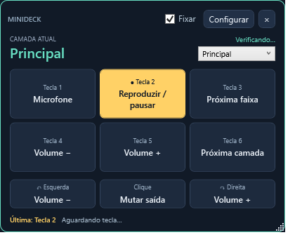
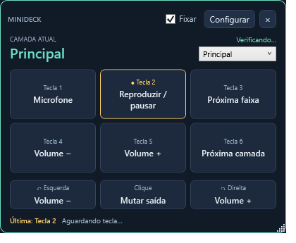

# MiniDeck PT-BR

[](https://github.com/VikThorSkynet/minideck-ptbr/actions/workflows/windows.yml)
[](https://github.com/VikThorSkynet/minideck-ptbr/releases/latest)
[](LICENSE)

Transforme um mini teclado USB em um painel de atalhos, áudio e sons, com interface em **português do Brasil**.

O MiniDeck foi desenvolvido para substituir o configurador de um teclado USB **VID `1189` / PID `8890`**, inicialmente com **6 teclas e 1 knob**. Permite criar camadas de funções, controlar o áudio de aplicativos e microfones, tocar sons e acompanhar tudo em uma janela compacta na segunda tela.

<p align="center">
  
</p>

> A imagem usa um perfil de demonstração. O projeto foi validado com uma unidade desse teclado; o mesmo VID/PID pode aparecer em outros firmwares. Confira a [compatibilidade e os limites](docs/COMPATIBILIDADE.md) antes de preparar outro aparelho.

## Baixar e usar

1. Abra a [última versão](https://github.com/VikThorSkynet/minideck-ptbr/releases/latest).
2. Baixe o arquivo `MiniDeck-PTBR-vX.Y.Z-win-x64.zip` e extraia a pasta inteira.
3. Execute **MiniDeck.exe**. A distribuição de release inclui o runtime; não exige instalar o SDK.
4. Confira o layout, escolha suas ações e clique em **Ativar camadas** para preparar o teclado.
5. Mantenha o MiniDeck aberto ou minimizado na bandeja enquanto usa os recursos de software.

**Preparar o teclado substitui os comandos das entradas selecionadas na memória nativa disponível.** Não existe comando de leitura recuperado para salvar a configuração anterior do aparelho. O perfil exportado contém os ajustes do MiniDeck, não um backup da memória do teclado.

Requisitos: **Windows 10/11 x64**, teclado compatível e, para sons, uma saída de áudio ativa. Use apenas um dispositivo desse modelo conectado durante a configuração.

## O que dá para fazer

| Recurso | Como funciona |
|---|---|
| Camadas de funções | Até 100 camadas; próxima, anterior, destino específico e mudança enquanto segura uma tecla. |
| Atalhos externos por camada | Teclas em Sem ação enviam combinações distintas para cadastrar diretamente no OBS ou em outro programa; o gatilho físico original é bloqueado. |
| Painel compacto | Mostra a camada atual e os nomes das teclas/knob; pode ser movido, redimensionado e fixado sobre outras janelas. |
| Identificação da tecla | Cartão amarelo enquanto segura e por 2 segundos após soltar; bolinha, borda e indicador da última entrada permanecem visíveis. |
| Soundboard | MP3/WAV, arquivo por botão, volume individual, saída de áudio, reinício, tocar/parar, sobreposição e repetição. |
| Volume dos sons | Controle geral em tempo real, pelo painel ou por teclas/knob, com mudo e parada de todos os sons. |
| Áudio por aplicativo | Aumentar, diminuir, mutar e definir o volume de sessões pelo nome do processo. |
| Microfone e saída | Escolha do dispositivo e ajuste de volume/mudo no Windows. |
| Atalhos e texto | Captura de combinações, envio de atalhos e digitação de texto Unicode. |
| Mídia e mouse | Play/pause, faixas, volume; cliques e rolagem, inclusive com modificadores. |
| Arquivos e programas | Abrir arquivos, pastas e sites; executar programas com argumentos e pasta de trabalho. |
| Macros | Até 100 passos, pausas de até 10 minutos, 1–100 repetições e cancelamento. |
| LED | Envio dos três modos encontrados no software fornecido: 0, 1 e 2. |
| Memória do teclado | Gravação direta de atalhos/sequências de até 5 passos, mídia e mouse nas camadas nativas disponíveis. |
| Perfis | Exportação/importação em JSON, cópia da última versão salva e duplicação de camadas. |
| Bandeja e instância única | Continua funcionando ao minimizar; abrir novamente reutiliza o processo. |

O layout configurável aceita **1–12 teclas e 0–2 knobs**. No modo de camadas, há um limite de **12 entradas no total**; cada knob conta como três entradas: esquerda, clique e direita.

## Colocar sons em uma camada

1. Clique em **+ Sons**.
2. Escolha uma tecla e a ação **Sons · tocar arquivo MP3 / WAV**.
3. Clique em **Escolher som…**, selecione o arquivo, a saída de áudio e o volume.
4. Defina o comportamento ao apertar de novo e, se quiser, marque **Repetir até eu mandar parar**.
5. Clique em **Salvar ação** e use a tecla física. **Testar ação em 3 segundos** permite experimentar antes de salvar.

Na camada criada pelo botão **+ Sons**, a última tecla muda de camada e o knob controla o volume dos sons. **Parar sons** encerra todas as reproduções; no compacto, o botão **♪ ■** aparece enquanto existe som tocando. Até 16 sons podem tocar simultaneamente.

Para o áudio entrar na gravação, o OBS precisa capturar o áudio do **MiniDeck** ou a **saída escolhida**. É possível selecionar uma saída de Voicemeeter/cabo virtual já instalado. O MiniDeck não configura automaticamente as cenas do OBS. Veja [sons e gravação](docs/SONS-E-GRAVACAO.md).

## Usar na segunda tela

Clique em **Modo compacto**, arraste o cabeçalho para a outra tela e ative **Fixar**. O painel acompanha a camada mesmo quando a troca vem do teclado físico. **Configurar** volta ao editor; o **×** apenas oculta o painel.

<p align="center">
  
</p>

## LED e compatibilidade

Os modos 0, 1 e 2 são os únicos encontrados no configurador analisado. **Não há controle comprovado de RGB, brilho, velocidade ou LED individual**, nem leitura de volta da configuração. Os efeitos físicos precisam ser conferidos em cada unidade. **Cor do painel** muda apenas a identificação da camada na tela; trocar uma camada de software não altera automaticamente o LED.

O teclado continua usando F13–F24 como gatilhos internos. O modo **Atalhos exclusivos por camada**, ativado por padrão, reserva os F13–F24 físicos usados pelo layout e envia somente o atalho da camada ou a ação configurada. Esse bloqueio usa um hook do Windows e abrange essa faixa em **todos os teclados** enquanto as camadas estão ativas e uma única unidade está conectada. Ao desmarcar o modo, a entrada volta a ser filtrada por dispositivo via Raw Input e os gatilhos originais podem chegar aos outros programas. Não instala driver, serviço ou firmware.

## Configurar atalhos diretamente em outro programa

Deixe **Atalhos exclusivos por camada** marcado, escolha **Sem ação** na tecla e salve. Cadastre no programa de destino a combinação mostrada no editor/compacto. Para seis teclas:

| Banco de camada | Faixa reservada às teclas |
|---|---|
| 1 | F13–F18 |
| 2 | F19–F24 |
| 3 | Ctrl+F13–F18 |
| 4 | Ctrl+F19–F24 |

Depois vêm Alt, Shift e combinações desses modificadores. O [Windows define teclas F até a F24](https://learn.microsoft.com/en-us/windows/win32/inputdev/virtual-key-codes), portanto não existe F25 para continuar a numeração. Há **96 combinações automáticas**, equivalentes a 16 bancos de seis teclas. O limite de 100 camadas de ações do MiniDeck continua; bancos além da faixa automática exigem uma ação ou um atalho manual. Knobs em Sem ação não recebem atalho automático.

**Ao atualizar da versão 1.2, recadastre os atalhos nas outras aplicações.** Por exemplo, a tecla 5 da terceira camada passa de F17 para Ctrl+F17. Uma tecla com ação, como trocar camada ou tocar som, não envia um F adicional. Pressão/liberação são preservadas para atalhos enquanto segura. Os bancos não mudam ao renomear ou excluir outra camada. Veja o [guia de atalhos por camada](docs/ATALHOS-POR-CAMADA.md).

## Compilar e testar

Instale o **SDK do .NET 8** e use PowerShell no Windows:

```powershell
git clone https://github.com/VikThorSkynet/minideck-ptbr.git
cd minideck-ptbr
.\compilar.ps1
.\testar.ps1 -ExecutablePath .\dist\win-x64\MiniDeck.exe
```

`compilar.ps1` gera a distribuição autocontida e o ZIP em `dist`. Para uma publicação que usa o runtime já instalado, use `-FrameworkDependent`.

A versão 1.3 inclui **54 testes de lógica**, verificações de interface e teste opcional de instalação/encerramento do hook nativo. Os testes de interface usam um perfil descartável. A versão 1.2 também teve sete verificações de áudio com sinal próprio e volume de amostras em zero. A CI executa lógica, sem exigir teclado ou dispositivo de áudio. Os testes automatizados não confirmam a integração física com atalhos globais de outros programas; confira no aplicativo de destino.

Leia [desenvolvimento e testes](docs/DESENVOLVIMENTO.md) para executar as verificações opcionais.

## Documentação

- [Guia fácil de uso](docs/GUIA-DE-USO.md)
- [Todas as ações e seus parâmetros](docs/ACOES.md)
- [Atalhos externos exclusivos por camada](docs/ATALHOS-POR-CAMADA.md)
- [Sons, volumes, OBS e Voicemeeter](docs/SONS-E-GRAVACAO.md)
- [Compatibilidade e limitações](docs/COMPATIBILIDADE.md)
- [Arquitetura do programa](docs/ARQUITETURA.md)
- [Protocolo USB documentado](docs/PROTOCOLO-USB.md)
- [Desenvolvimento, testes e releases](docs/DESENVOLVIMENTO.md)
- [Perfil de exemplo para sons](examples/perfil-sons.json)
- [Histórico de versões](CHANGELOG.md)

## Contribuir

Encontrou um problema ou quer um recurso? Abra uma [issue](https://github.com/VikThorSkynet/minideck-ptbr/issues/new/choose). Para mudanças no código, consulte [CONTRIBUTING.md](CONTRIBUTING.md). Não publique perfis, diagnósticos ou gravações pessoais sem revisar seu conteúdo.

Código do MiniDeck sob [licença MIT](LICENSE). Dependências e exclusões estão em [THIRD-PARTY-NOTICES.md](THIRD-PARTY-NOTICES.md). Projeto independente, inspirado no uso de painéis de atalhos; sem vínculo com a Elgato ou fabricantes do aparelho.
