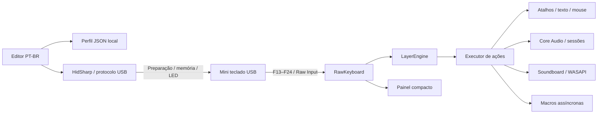

# Arquitetura

Aplicativo Windows em C#/.NET 8, interface WPF e ícone de bandeja via Windows Forms. O código está em [MiniDeck no GitHub](https://github.com/VikThorSkynet/minideck-ptbr/tree/main/MiniDeck).

## Componentes

| Arquivo | Responsabilidade |
|---|---|
| `Program.cs` | Entrada STA, instância única, eventos locais entre instâncias e modos de teste/diagnóstico. |
| `Models.cs` | Perfil, ações, camadas, layout, validação estrutural, catálogo e persistência. |
| `Input.cs` | Raw Input, filtro VID/PID, supressão de repetição, camadas e envio de entrada pelo Windows. |
| `Hardware.cs` | Quadros USB, descoberta da interface, transporte HID e preparação de F13–F24. |
| `NativeBindings.cs` | Conversão de atalhos, mídia e mouse para comandos nativos. |
| `MainWindow.xaml(.cs)` | Editor, navegação, perfis, iluminação, gravação e bandeja. |
| `MainWindow.Actions.cs` | Edição, execução de ações e controles dos sons. |
| `ActionEditor.cs` | Campos dinâmicos conforme o tipo de ação e captura de atalhos. |
| `ActionRules.cs` | Validação de parâmetros e descrição das ações. |
| `CompactWindow.xaml(.cs)` | Painel compacto, indicadores, tamanho, posição e fixação. |
| `AudioService.cs` | Dispositivos, sessões por processo e volume/mudo do Windows. |
| `SoundboardService.cs` | Reprodução de arquivos, saídas independentes, volumes internos e limpeza dos recursos. |
| `SequenceRunner.cs` | Macro assíncrona, repetição, espera e cancelamento. |
| `MacroEditorWindow.cs` | Montagem visual dos passos. |
| `SelfTests.cs`, `SoundboardTests.cs`, `UiSmoke.cs` | Testes de lógica, protocolo, sons e interface. |

## Entrada e camadas

A preparação grava F13–F24 nas entradas do aparelho. `RawKeyboard` registra Raw Input, verifica o nome do dispositivo e só despacha o VID/PID esperado. O painel recebe a pressão antes da resolução da ação, preservando o destaque durante uma troca de camada.

`LayerEngine` mantém a camada permanente e uma pilha de camadas enquanto segura. A liberação remove a entrada correspondente, mesmo quando a ação no destino tem outro significado. As ações comuns são entregues ao executor. Os gatilhos não são suprimidos dos demais aplicativos.

## Áudio

`AudioService` usa NAudio/Core Audio para ajustar dispositivos ou sessões. `SoundboardService` decodifica arquivos via Media Foundation e entrega amostras a saídas WASAPI em modo compartilhado. O volume do soundboard é aplicado às amostras, sem usar `WasapiOut.Volume`, que alteraria o volume do dispositivo.

Cada reprodução tem seus recursos de arquivo e saída; término, parada, substituição e falha os liberam. O fim da reprodução agenda a limpeza fora da thread de reprodução. O limite é de 16 vozes. A interface `ISoundVoice` permite testar reinício, sobreposição, volume e encerramento sem um dispositivo real.

## Persistência e instância única

O perfil é salvo em `%LOCALAPPDATA%\MiniDeck\perfil.json`. A gravação usa arquivo temporário e preserva a versão anterior em `.bak`. Os campos novos têm valores padrão para manter perfis anteriores legíveis. A versão estrutural do JSON continua sendo 1.

Mutex e eventos nomeados com escopo `Local\MiniDeck-*` reutilizam a instância aberta para mostrar o compacto, abrir configurações ou encerrar. O fluxo normal não usa rede ou um servidor local.
